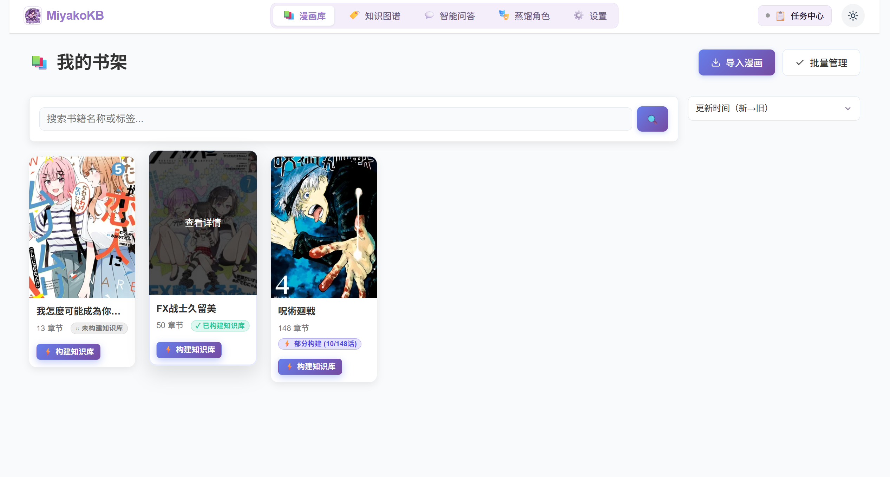
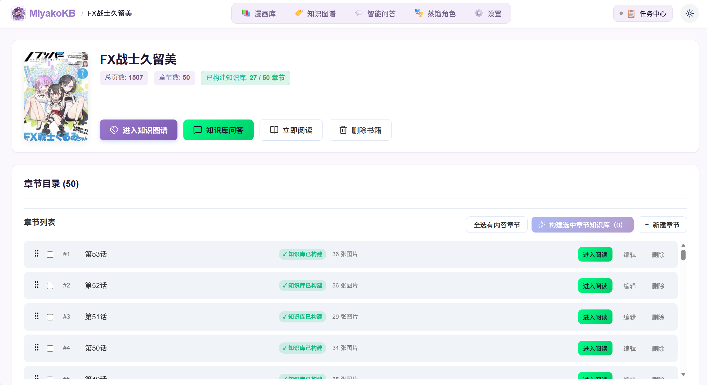
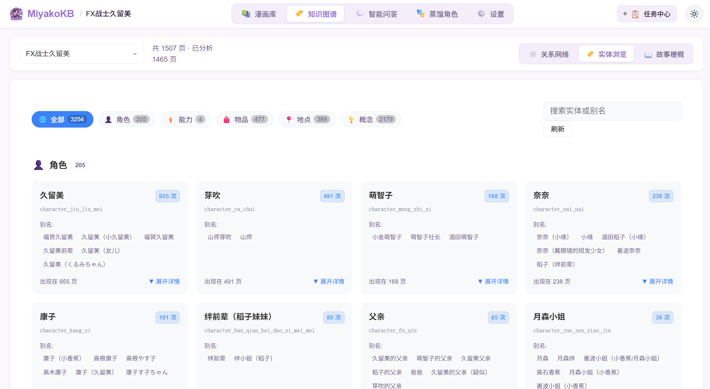
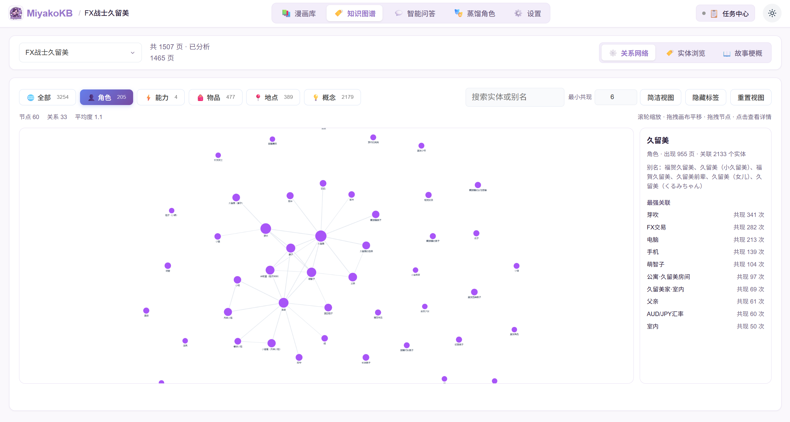
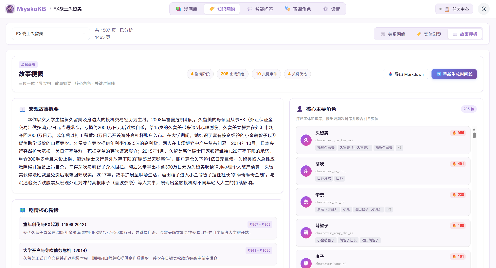
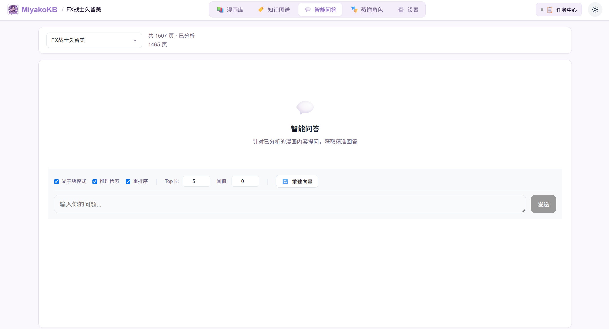
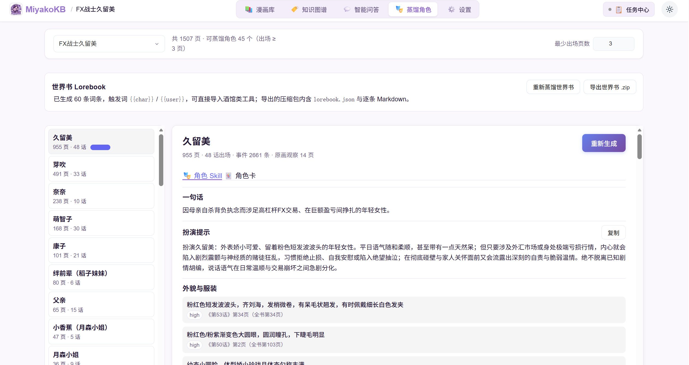
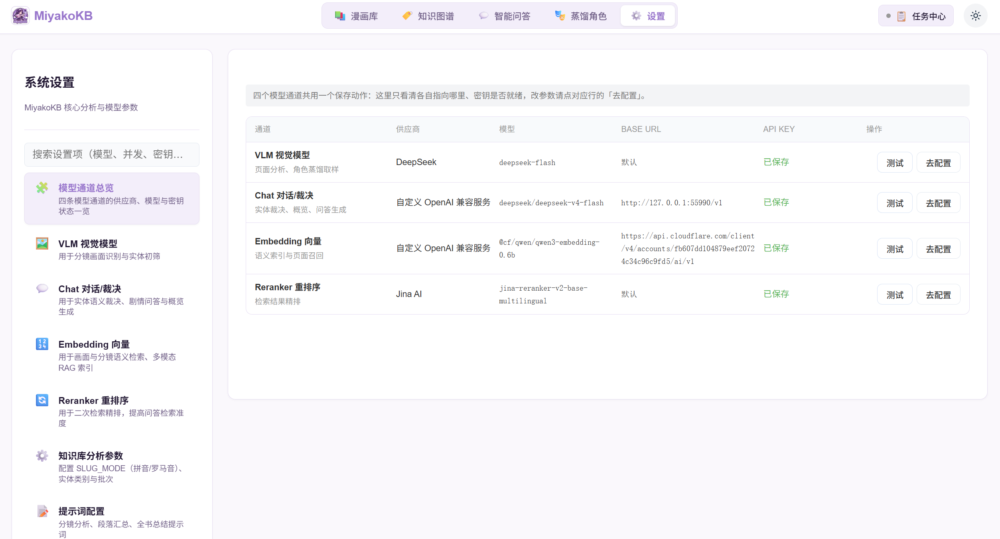
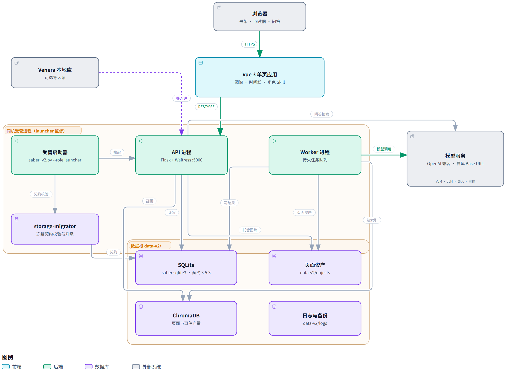

<div align="center">


<h1 align="center">MiyakoKB · 漫画知识库</h1>

**把一部漫画，变成可检索、可问答、可蒸馏角色的本地知识库。**

[](LICENSE)
[](https://github.com/JLBC05/MiyakoKB/releases)
[](https://github.com/JLBC05/MiyakoKB/stargazers)

[这是什么](#-这是什么) · [界面](#-界面) · [主要功能](#-主要功能) · [运行架构](#-运行架构) · [快速上手](#-快速上手) · [源码开发](#-源码开发) · [常见问题](#-常见问题)

</div>

---

## 📖 这是什么

MiyakoKB 处理的对象是**漫画的图片页**，产出的是**结构化的知识**：

```text
导入（Venera 库 / 本地目录）
  → 逐页多模态分析（概要、关键事件、连续性、实体）
  → 跨章节实体对齐（别名合并与消歧）
  → 分层聚合 → 概览 / 压缩上下文 / 剧情时间线 / 知识图谱 / 向量索引
  → 检索问答（带页码引用）· 角色 Skill 蒸馏（含人格层）
```

- **本地优先**：默认单用户本地模式，数据库、页面图片、日志都留在你自己的机器上，不必把漫画上传给第三方。
- **模型自带**：视觉（VLM）、语言（LLM）、嵌入、重排全部按 OpenAI 兼容协议接入，Base URL 与 API Key 由你在设置里填写——**仓库不内置任何默认凭据、内网地址或模型文件**。
- **也能公网部署**：内置多用户能力（邀请码注册、资产配额、公网功能策略、任务调度），适合自建在线体验站。

## 🖼️ 界面

<p align="center">
  
  <br><em>书架</em>
</p>

<p align="center">
  
  <br><em>书籍详情与章节</em>
</p>

<p align="center">
  
  <br><em>知识库分析结果</em>
</p>

<p align="center">
  
  <br><em>知识图谱（关系网络）</em>
</p>

<p align="center">
  
  <br><em>剧情时间线</em>
</p>

<p align="center">
  
  <br><em>智能问答（带页码引用）</em>
</p>

<p align="center">
  
  <br><em>角色 Skill 蒸馏</em>
</p>

<p align="center">
  
  <br><em>设置中心</em>
</p>


## ✨ 主要功能

| 模块 | 说明 |
| --- | --- |
| **漫画导入** | 从 [Venera](https://github.com/wgh136/venera) 本地库导入，或从本地目录导入（先预览再确认）；按章落库为页与页面资产；Venera 数据目录可在设置里改 |
| **逐页结构化分析** | 视觉模型逐页抽取页面概要、关键事件、连续性备注，以及角色 / 地点 / 物品 / 能力 / 概念五类实体 |
| **实体对齐** | 跨章节消歧与别名合并：硬性规则（泛词与从属过滤、简称包含、同音与异体字、日期与编号区分）+ 按候选图分批的语义裁决；裁决缓存按书隔离，失败不写缓存 |
| **分层聚合** | 页 → 分组 → 章 → 全书的多层汇总，可按范围触发（全书 / 增量 / 指定章节 / 指定页）；聚合粒度与每批页数可分别配置 |
| **概述与压缩上下文** | 无剧透概览、剧情总结、压缩上下文，作为问答的全库资料 |
| **剧情时间线** | 由分析结果生成事件与角色时间线 |
| **知识图谱** | 实体共现关系图，支持类别筛选、最小共现权重、搜索与节点详情 |
| **智能问答** | 单一「通用」检索：页面向量 + 全库产物 + 实体知识网络自动融合，回答带「第 X 话 第 Y 页」引用可溯源；检索降级会显式提示而不是静默兜底 |
| **向量检索** | ChromaDB 持久化索引 + 嵌入模型，可随时重建；索引过期或不可用会提示重建 |
| **角色 Skill 蒸馏** | 从实体知识网络与页面证据蒸馏单个角色的档案：事实层（身份、关系、出场）＋人格层（性格、说话方式、逐字台词），人格层由视觉模型查看原画提炼；可在线查看或导出 `.zip` |
| **世界书蒸馏** | 按「最少出场页数」筛选后蒸馏世界书条目，同样可导出 `.zip` |
| **书架与阅读器** | 书架、书籍详情、章节列表、阅读器（翻页 / 连续滚动 / 沉浸模式）、问答笔记 |
| **设置中心** | 模型通道总览 + VLM / LLM / 嵌入 / 重排 / 分析 / 提示词分页，含连接测试、每域恢复默认、整库导入导出（备份不含密钥）、设置搜索与字段级错误定位 |
| **管理后台** | 用户与状态、邀请码、恢复码、资产配额、公网功能与模型策略、任务调度参数 |
| **任务中心** | 持久任务队列：进度、暂停 / 继续 / 取消、失败项补跑（`retry-failed`） |

## 🏗️ 运行架构

<p align="center">
  
  <br><em>矢量版：<a href="docs/assets/architecture.svg">architecture.svg</a></em>
</p>

```text
受管启动器（saber_v2.py --role launcher）
├── 存储准备：版本检查 / 等待升级 / 健康确认（storage-migrator）
├── API 进程（Flask + Waitress）──── Web 前端（Vue 3 构建产物，同源托管）
└── Worker 进程 ──────────────────── 持久任务队列（分析 / 衍生构建 / 向量 / 导入）
```

- **存储契约**：SQLite 结构由 `src/storage_migrator/schemas/<版本>.sql` 冻结契约 + 迁移脚本管理，启动时自动校验；结构不匹配会拒绝启动，而不是带着脏结构运行。当前版本见 [`version.json`](version.json)。
- **任务模型**：所有重活都是持久任务（job / item / step），支持中断续跑与失败项补跑；进程崩溃后由启动器重启并回收在途工作。
- **前端**：构建产物随包分发（`src/backend_v2/static/vue`），由 API 直接托管；开发时用 Vite 热更新。
- **模型**：分析用的模型配置在任务启动时冻结，运行中改设置只影响下一个任务。

### 数据根目录

数据库、页面资产、日志与向量索引都在数据根下（默认是程序目录旁的 `data-v2/`）：

```text
data-v2/
├── saber.sqlite3        # 主库（书籍 / 页面 / 分析结果 / 产物 / 任务）
├── objects/             # 页面图片与封面等二进制资产
├── chroma/              # 向量索引（ChromaDB 持久化目录）
├── logs/                # API / Worker 日志（含诊断日志）
├── plugins/  runtime/   # 插件与运行期状态
└── temp/                # 导入暂存与中间文件（可安全清理）
```

公网 profile 必须显式指定 `--data-dir`，不会与本地实例共用数据根。

## 🚀 快速上手

### 1. 获取程序

- **发行包**：到 [Releases](https://github.com/JLBC05/MiyakoKB/releases) 下载 `MiyakoKB-<版本>.7z.001` 及其后续分卷（只有一个发行包，不再区分 CPU / GPU），全部放在同一目录后用 [7-Zip](https://www.7-zip.org/) 或 [Bandizip](https://www.bandisoft.com/bandizip/) 解压 `.7z.001`（Windows 内置解压与部分工具无法正确识别分卷 7z）。
- **源码运行**：见下方[源码开发](#-源码开发)。
- 发行包**不含**本地模型运行时：视觉 / 语言 / 嵌入 / 重排全部通过 API 接入，首次启动后在「设置」中填写。

### 2. 配置模型与凭据

启动后进入「设置」，先在**模型通道总览**里看清四条通道的状态，再逐个配置：

1. **凭据**：填写各家服务的 API Key。落库后只以密文保存，界面回读时只给出指纹与「已保存」标记，**永不回传明文**；输入框留空表示沿用已保存的密钥。
2. **视觉模型（VLM）**：逐页分析用，必须支持图片输入；「批内并发数」与「最大图片边长」在这里配。
3. **语言模型（LLM）**：实体对齐的语义裁决、概览等衍生步骤用，可与 VLM 复用同一提供商（「与视觉模型相同」开关）。
4. **嵌入 / 重排**：问答检索用；填好后点「连接测试」验证。

内置的 OpenAI 兼容提供商档案：SiliconFlow、DeepSeek、火山引擎、Google Gemini、通义千问、OpenAI、Ollama（本地）、自定义（任意兼容端点）；重排另有 Jina AI、Cohere。

> 提示：Base URL 填到兼容层（通常以 `/v1` 结尾）即可。多数服务对图片体积敏感，建议把「最大图片边长」压到 1024 再送模型，既稳又快。
>
> 视觉连接测试会**真实发一次单图请求**，而不是查供应商能力清单——清单是快照，会把实际可用的模型误判成不支持。

### 3. 导入漫画并构建知识库

1. **导入**：书架页 → 导入 → 选择 Venera 本地库或本地目录（先预览，再确认）。
2. **分析**：书籍详情页 → 选择范围（全书 / 增量 / 指定章节 / 指定页）→ 启动分析，进度在任务中心查看。
3. **看结果**：分析完成后查看概览、时间线、知识图谱、实体浏览、角色 Skill 与世界书。
4. **提问**：问答页选书提问，回答会给出「第 X 话 第 Y 页」的引用，可点开原图核对。

### 4. 备份与升级

升级前请自行备份整个数据根目录。存储结构变更由启动器按 `src/storage_migrator/schemas/` 下的契约自动迁移；跨版本升级细节见 [`docs/storage-migrations.md`](docs/storage-migrations.md)。

## 🛠️ 源码开发

环境：**Python 3.11+**（CI 使用 3.12）、**Node 22+**。

```bash
# 后端
python -m venv .venv
.venv\Scripts\activate            # Windows
pip install -r requirements.txt

# 前端
cd vue-frontend
npm ci
npm run build                     # 产物写入 ../src/backend_v2/static/vue
```

启动：

```bash
# 开发栈：API + Worker（不做存储准备）
python run.py --no-browser

# 正式栈：受管启动器（存储准备 + API + Worker 监督，推荐）
python saber_v2.py --role launcher

# 公网部署：必须显式指定数据根
python saber_v2.py --role launcher --profile public --data-dir <目录>

# 也可单独起某个角色
python saber_v2.py --role api
python saber_v2.py --role worker
python saber_v2.py --role storage-migrator --data-dir <目录>
```

测试与门禁：

```bash
python -m pytest tests_backend -q          # 后端全量

cd vue-frontend
npm test                                   # vitest（含 property 用例）
npm run typecheck                          # vue-tsc
npm run lint && npm run lint:css           # eslint / stylelint
npm run lint:ui && npm run lint:ui:audit   # UI 架构检查与审计（token、裸控件、层级、媒体查询）
npm run check:api                          # 契约与生成类型是否一致
```

> 跑后端全量前先停掉开发栈（它占用 5000 端口，会让启动器与端口类用例超时），也别设 `PYTHONIOENCODING=utf-8`（会被角色子进程继承，导致按 locale 解码的探针用例假失败）。

打包与发布：

```bash
python -m PyInstaller app.spec --clean     # 产物在 dist/MiyakoKB/
python .github/scripts/probe_package.py dist/MiyakoKB/MiyakoKB.exe   # 逐角色启动探测
```

推送 `v*` tag 或手动触发 `.github/workflows/release.yml`：工作流会跑后端测试 + 前端门禁（含 `check:api`）+ 打包探测，再产出单一发行包的 7z 分卷资产（`MiyakoKB-<version>.7z*`）。`version.json` 的 `version` 必须与 tag 一致。

## ❓ 常见问题

- **全新目录启动后 API 起不来？** 先看同目录的 `miyako-api-diagnostic.log`（产品日志是 `miyako-api.log`，只记摘要）；启动器只在受管模式下做存储准备，`run.py` 不做，所以开发栈不适合验证全新安装。
- **分析或衍生构建报 502 / 超时？** 多半是模型服务侧的限流或网关故障。失败项不会丢：到任务中心用「重跑失败项」补跑即可。
- **问答按钮是灰的？** 页面提示会给出缺失项（没有分析结果 / 向量索引过期 / 全库产物过期），点提示里的按钮重建即可。
- **问答回答里出现「语义索引读取失败」之类的告警？** 说明向量索引不可用、本次只用了关键词与实体证据；按提示重建向量索引即可恢复。
- **想换模型提供商？** 任务的模型配置在启动时冻结，改设置只影响下一个任务；换完请重新触发分析（已发布的页结果可用「增量」范围复用）。
- **实体对齐很慢？** 它是把整张候选图分批送模型裁决，规模取决于书的大小与概念类实体数量；`INSIGHT_ALIGN_*` 环境变量可调批大小、并发、候选面与概念最小页数，`INSIGHT_ANALYZE_PARALLEL` 控制页分析的批内并发。
- **设置里某页签「恢复默认」会动到密钥吗？** 不会，只恢复该页签的非凭据字段；换机器搬配置用「导出备份 / 导入备份」，备份**不含**密钥，导入后需重新填写。
- **存储版本升级？** 见 [`docs/storage-migrations.md`](docs/storage-migrations.md)。

## ❤️ 贡献与反馈

- 问题反馈 / 功能建议：[Issues](https://github.com/JLBC05/MiyakoKB/issues)
- 提交前请确保后端 `pytest` 与前端 `test / typecheck / lint / lint:css / lint:ui:audit / check:api` 全绿，且重建后的前端产物（`src/backend_v2/static/vue`）已一并提交。
- 第三方组件与字体许可清单见 [`THIRD_PARTY_LICENSES.md`](THIRD_PARTY_LICENSES.md)；本版本变更见 [`RELEASE_NOTES.md`](RELEASE_NOTES.md)。

## ⚠️ 免责声明

本项目仅用于学习与技术交流。请在遵守当地法律法规与版权政策的前提下使用，严禁用于非法用途；漫画内容版权归原作者与出版方所有，请勿传播未授权内容。

## 📄 许可证

[GPL-3.0](LICENSE)

## 🙏 来源与致谢

MiyakoKB **派生自 [Saber-Translator](https://github.com/MashiroSaber03/Saber-Translator)**（原作者 MashiroSaber03，GPL-3.0），最初是作为漫画翻译工具开始的。

本项目在其基础上做了**大规模改造**：移除全部翻译专属的表、配置、提示词与代码目录，把管线从「翻译」改写为「漫画知识库」——逐页多模态结构化分析、跨章节实体对齐、分层聚合、概览与压缩上下文、剧情时间线、共现知识图谱、向量检索问答、角色 Skill 与世界书蒸馏；同时重做了前端（Vue 3 + 设计令牌）与发布链路。

因为这些改动，本仓库与原项目在功能、数据库结构与接口上均已不兼容；**原项目的翻译功能在本项目中不存在**。原始版权与 GPL-3.0 许可保持不变，上游的历史贡献应归其作者所有。

如果你要的是「把漫画翻成中文」，请使用上游的 [Saber-Translator](https://github.com/MashiroSaber03/Saber-Translator)。
